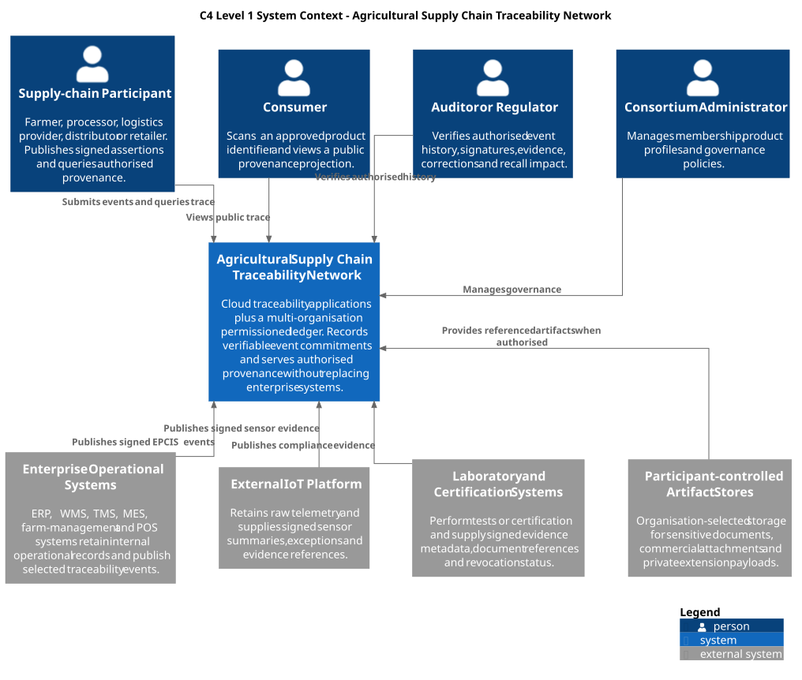
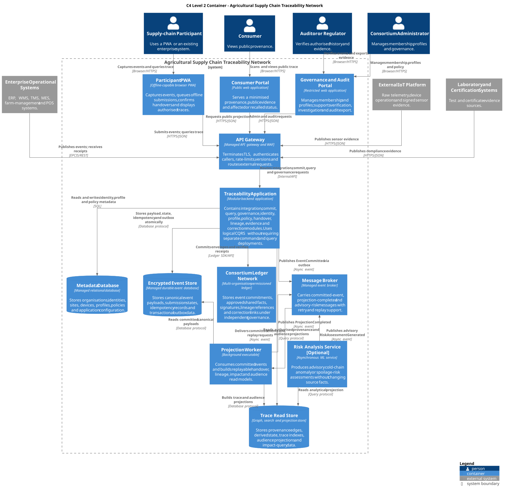
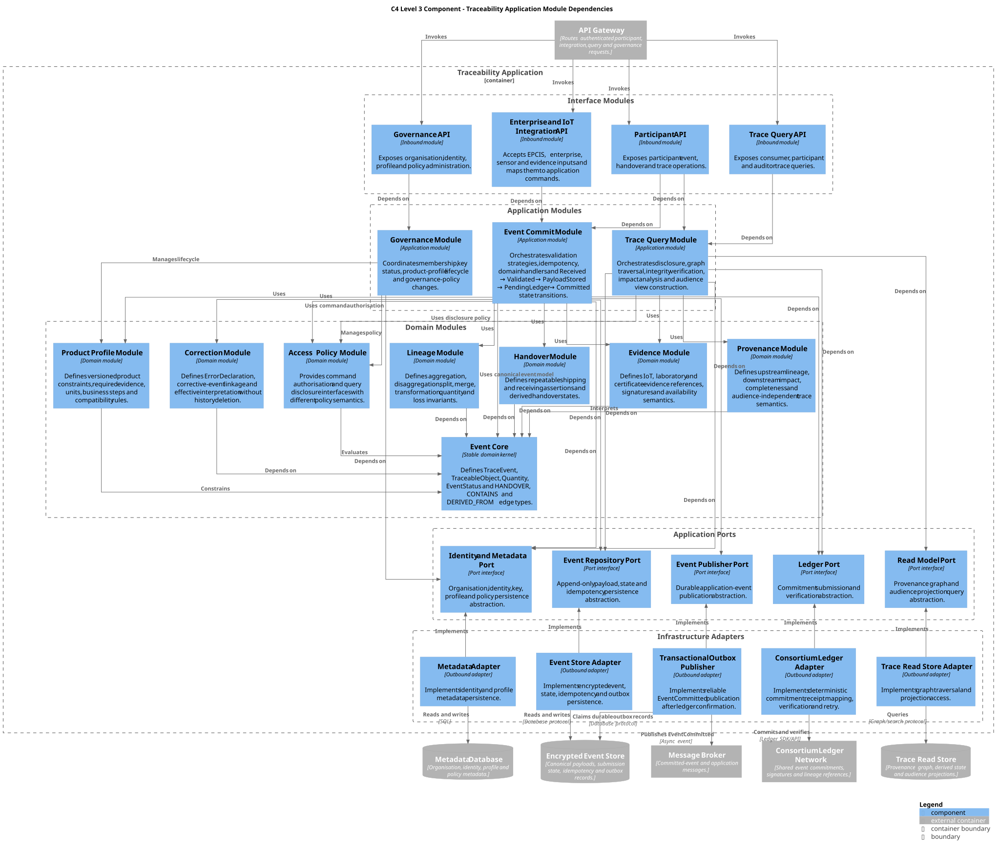
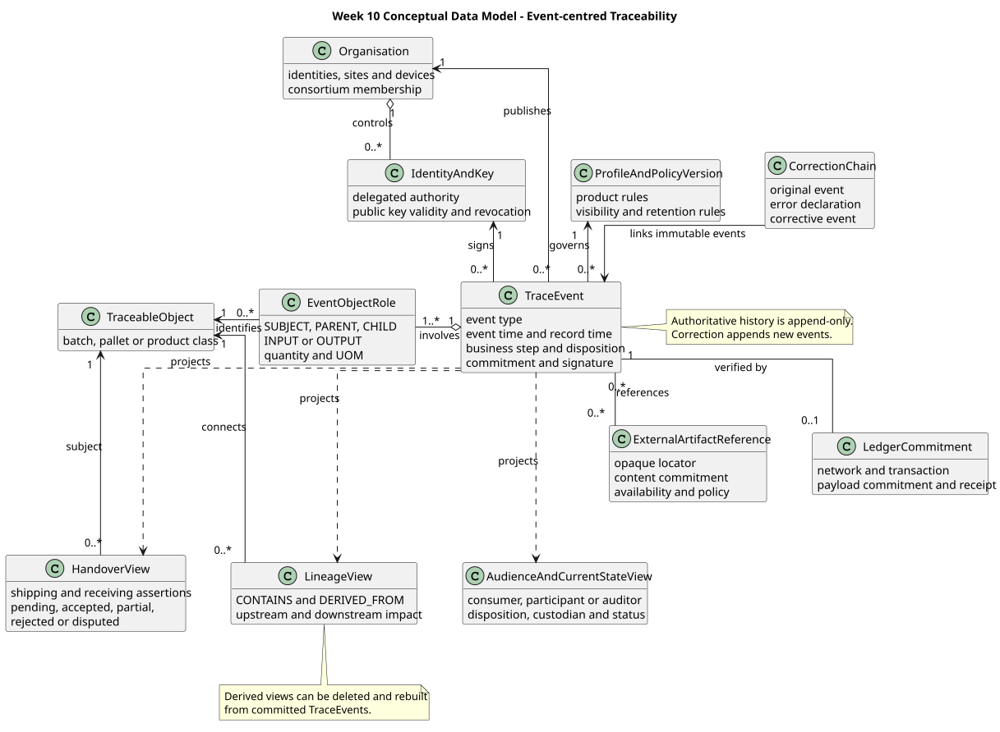
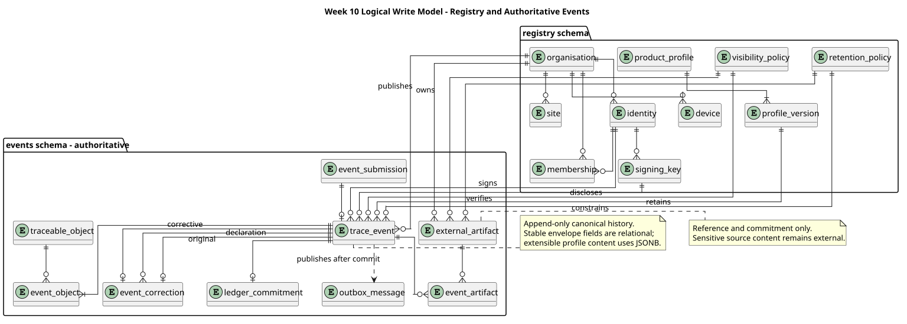
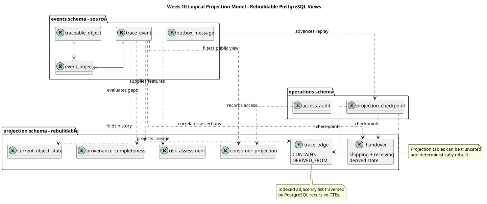
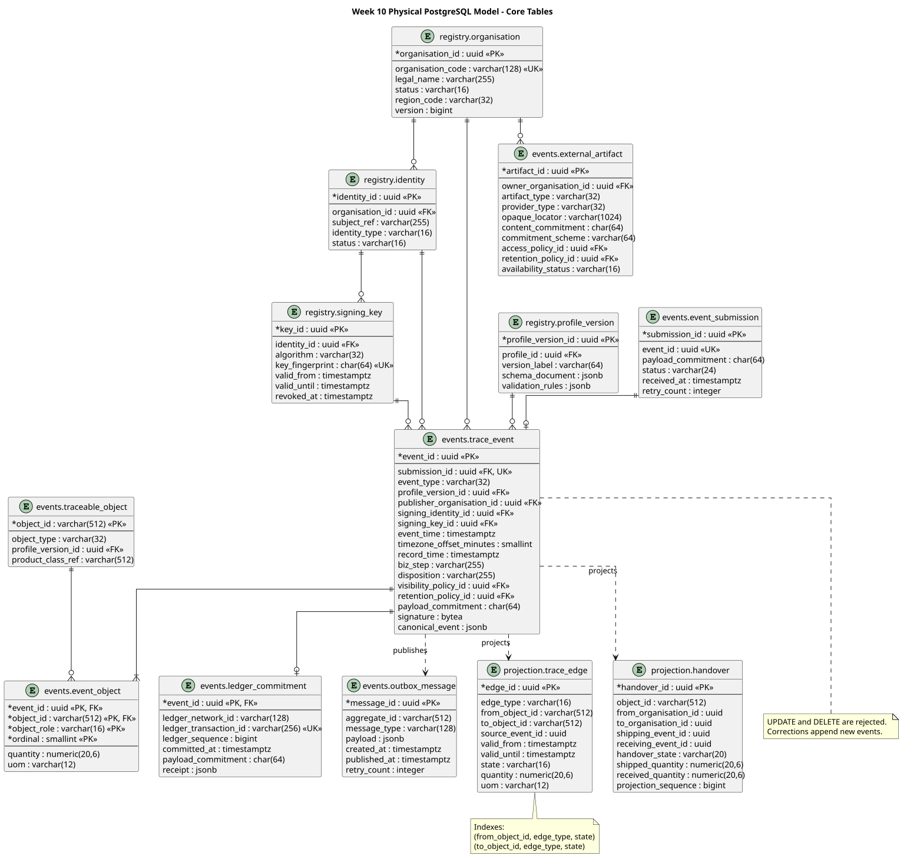

# Agricultural Supply Chain Traceability Network

## Software Architecture Report

**Subject:** 48433 Software Architecture  
**Team:** [Insert Canvas group and team-member names]  
**Tutor:** [Insert tutor]  
**Submission date:** 23 October 2026  
**Document version:** Working Draft  

<!--
WORKING INSTRUCTIONS — remove before submission.

Maximum report length: 5,000 words.
Suggested body-word budget:
- Executive summary: 150
- Section 1 Project Context: 500
- Section 2 Requirements Analysis: 1,200
- Section 3 Architecture Views: 800
- Section 4 Architectural Rationale: 1,700
- Section 5 Evaluation and Alternatives: 550
- Conclusion: 100

Use this paragraph pattern for every major decision:
Driver → Decision → Mechanism → Consequence/trade-off → Rejected alternative → Evidence.

Do not leave TODO comments, working-status labels, unsupported legal claims, or internal file paths in the submitted version.
The signed Contribution Table is mandatory. The glossary appendix must not exceed three pages.
-->

## Executive Summary

<!-- 120–150 words. State the problem, architecture thesis, major decisions and evaluation conclusion. -->

The proposed system is a cross-organisation traceability network rather than a full enterprise resource planning system. Independent agricultural supply-chain organisations publish signed traceability events through a platform interface or integration API. Canonical events are retained as append-only history in PostgreSQL, while a multi-organisation permissioned ledger stores minimal verifiable commitments. Rebuildable projections provide authorised provenance, handover and recall-impact queries. Enterprise operational records, raw IoT telemetry and sensitive artifacts remain under the control of their source organisations.

<!-- TODO: Replace the final sentence with the completed architecture-evaluation conclusion. -->

# 1 Project Context

## 1.1 Problem and Purpose

Agricultural products pass through multiple independent organisations before reaching consumers. Each organisation may maintain separate operational records, use different identifiers and describe events differently. This fragmentation delays provenance investigation and targeted food-safety response. The system therefore needs to connect independently produced assertions into an authorised, verifiable history without requiring every participant to adopt one shared ERP or trust one platform operator to control the complete record.

The proposed Agricultural Supply Chain Traceability Network provides participant interfaces, enterprise integration, IoT-evidence integration, cross-organisation event validation, ledger commitments, provenance queries, consumer views and audit support.

<!-- Explain why this problem affects architecture: organisational distrust, data ownership, weak connectivity, privacy, scale and interoperability. -->

## 1.2 Business Objectives

| ID | Business objective | Architectural implication | Evaluation evidence |
|---|---|---|---|
| BO-1 | Trace agricultural products from source to consumer across multiple organisations | Event-centred provenance using handover, containment and derivation relationships | End-to-end reference scenario and impact query |
| BO-2 | Improve record integrity and auditability | Signatures, append-only events and consortium-ledger commitments | Hash/signature verification and correction history |
| BO-3 | Reduce the scope and time of food-safety investigation | Rebuildable PostgreSQL trace projections and downstream impact analysis | Proposed 10,000-edge, five-second p95 target |
| BO-4 | Support small rural participants and established enterprises | Offline-capable PWA plus versioned EPCIS/REST integration | Offline submission scenario and idempotency |
| BO-5 | Support multiple product lines and regions without redesigning the core | Stable event model plus versioned product and regional profiles | Dairy-profile change scenario |
| BO-6 | Protect private and commercially sensitive information | Audience projections and participant-controlled artifact stores | Disclosure-policy and artifact-reference tests |

## 1.3 Stakeholders and Architectural Interests

| Stakeholder | Need or interest | Why architecturally relevant |
|---|---|---|
| Farmer or producer | Register batches and submit origin facts despite intermittent connectivity | Drives offline queue, delayed submission and simple participant UI |
| Processor or packer | Record transformation, re-batching and aggregation | Drives explicit input/output lineage and quantity rules |
| Logistics provider | Record custody changes and IoT evidence | Drives repeatable handover and evidence integration |
| Distributor or wholesaler | Split, aggregate, receive and redistribute quantities | Drives multi-hop relationships and partial-receipt handling |
| Retailer | Verify received products and expose approved consumer identifiers | Drives receiving assertions and consumer projection |
| Consumer | View understandable public provenance and safety status | Drives low-latency, allowlisted public view |
| Auditor or regulator | Inspect authorised history, commitments, evidence and corrections | Drives audit export, key history and trace completeness |
| Evidence provider | Reference IoT, laboratory or certification artifacts | Drives provider-neutral artifact references and commitments |
| Platform operator | Operate a secure and scalable SaaS application | Drives cloud operations, observability and separation of duties |
| Consortium administrator and node operators | Govern membership, profiles and ledger policy without unilateral platform control | Drives multi-organisation ledger and governance boundaries |

## 1.4 Risks and Constraints

| Risk or constraint | Relevance | Architectural response | Residual risk |
|---|---|---|---|
| Blockchain-based record keeping is mandatory | The solution must include immutable shared evidence | Permissioned ledger stores minimal event commitments | Ledger does not prove physical claims are true |
| False source data | Valid signatures can still attest to a false real-world claim | Attribution, evidence status, conflicting assertions and audit history | Requires external inspection and governance |
| Key compromise or platform impersonation | Could create apparently valid events | Organisation-specific keys, revocation history and KMS/HSM protection | Compromise before revocation remains investigable, not automatically false |
| Conflicting handover assertions | Sender and receiver may disagree | Independent shipping/receiving events and derived disputed state | Human or regulatory resolution may still be required |
| Rural connectivity | Events may be delayed or duplicated | Offline queue, stable event ID, retry and idempotency | Long disconnection delays shared visibility |
| Commercial-data leakage | Shared provenance can expose quantities, locations or documents | Policy-controlled projections and external artifacts | Incorrect classification remains a governance risk |
| Product and regional variation | Hard-coded schemas cause forks | Versioned profiles over a stable event core | Profile governance and migration still require discipline |
| Projection lag or corruption | Queries may be stale or incomplete | Checkpoints, replay, freshness metadata and reconciliation | Rebuild time grows with event volume |
| Consortium collusion | Multiple nodes could still cooperate dishonestly | Independent governance and optional future public anchoring | Public anchoring is not included in the initial baseline |

## 1.5 System Boundary and Exclusions

The platform stores and validates minimum traceability facts. It does not replace participants’ operational systems.

**Inside the boundary:** identities and profiles; signed event capture; handover; split, merge and aggregation lineage; correction; ledger commitment; authorised query; public projection; impact analysis; artifact references.

**Outside the boundary:** full ERP/WMS/TMS/MES/POS operations; payment and accounting; detailed inventory and route optimisation; laboratory testing; certificate issuance; regulatory enforcement; raw IoT fleet management; sensitive source documents; proof that a physical-world claim is inherently true.

<!-- Source: system-boundary.md. Condense rather than copying the whole working document. -->

## 1.6 Considered but Excluded Stakeholders and Capabilities

| Considered item | Exclusion rationale |
|---|---|
| Banks and payment processors | Payment and settlement do not contribute to provenance integrity in the selected scope |
| Warehouse-operations staff as a separate system role | Detailed picking and inventory operations remain in WMS; only traceability events cross the boundary |
| Vehicle-routing services | Route optimisation is not required to establish product lineage or custody history |
| General business-intelligence users | The first release provides trace and exception visualisation, not a general-purpose BI platform |
| Public-blockchain users | Public anchoring is a future alternative, not part of the initial network |

# 2 Requirements Analysis

## 2.1 System Requirements

| ID | Requirement | Stakeholders | Priority |
|---|---|---|---|
| FR-1 | Register organisations, identities, sites, devices and profile versions | Participants, consortium administrator | Must |
| FR-2 | Submit signed EPCIS-style traceability events through PWA or enterprise API | Participants | Must |
| FR-3 | Represent repeated handovers using independent shipping and receiving assertions | Participants, auditor | Must |
| FR-4 | Represent pallet containment, batch split, merge and transformation lineage | Processor, distributor, auditor | Must |
| FR-5 | Correct events without deleting or overwriting committed history | Participants, auditor | Must |
| FR-6 | Link IoT, certificate and laboratory evidence through external artifact references | Evidence providers, auditor | Must |
| FR-7 | Query upstream provenance and downstream impact | Participants, auditor | Must |
| FR-8 | Produce separate consumer, participant and auditor views | All query stakeholders | Must |
| FR-9 | Visualise batch timeline, lineage and approved IoT summaries | Participants, consumer | Must |
| FR-10 | Optionally generate advisory cold-chain risk assessments | Supply-chain manager | Could/bonus |

## 2.2 System Quality Requirements

| ID | Quality | Requirement and proposed measure | Stakeholder need |
|---|---|---|---|
| QA-1 | Integrity | A change to committed event content must be detectable through signature and ledger commitment verification | All participants, auditor |
| QA-2 | Auditability | Authorised auditors can retrieve publisher, signature, original event, corrections, evidence status and receipt | Auditor/regulator |
| QA-3 | Reliability | Client or server retries do not create duplicate accepted events | Rural participants and enterprise integrators |
| QA-4 | Rural accessibility | Participants can create attributable drafts offline and synchronise after reconnection | Farmer/producer |
| QA-5 | Query performance | Normal consumer trace returns within two seconds at p95 using projections | Consumer |
| QA-6 | Impact performance | Up to 10,000 authorised lineage edges are traversed within five seconds at p95 | Food-safety investigator |
| QA-7 | Availability | Public trace query targets 99.9% monthly availability and remains available during temporary ledger outage for committed data | Consumer and retailer |
| QA-8 | Scalability | Tenfold ingestion or query growth can be handled through horizontal application scaling and PostgreSQL tuning without changing the domain model | Platform operator |
| QA-9 | Privacy | Consumer response is constructed from an allowlisted projection and excludes restricted fields | Participants and consumer |
| QA-10 | Modifiability | A new product profile does not require changing the Event Core or ledger port | Consortium administrator and development team |
| QA-11 | Interoperability | Canonical events use versioned EPCIS concepts and controlled vocabulary | Enterprise participants |

<!-- State clearly that numeric measures are project assumptions because the case study supplies no workload. -->

## 2.3 Quality Attribute Scenarios and Alternatives

<!-- Use one table per priority scenario or one combined table. Do not merely define the quality. -->

| Scenario | Source and stimulus | Environment and artifact | Response and measure | Tactic/pattern | Alternative rejected |
|---|---|---|---|---|---|
| Offline duplicate submission | PWA retries the same event after reconnection | Intermittent network; submission API | Return the existing receipt; create one accepted event | Stable event ID, payload commitment, idempotency | Manual resubmission can lose or duplicate events |
| Consumer traffic spike | Public queries rise tenfold | Normal operation; query module and projection | Maintain two-second p95 through stateless replicas, cache/read tuning | Logical CQRS and projection | Ledger traversal couples query latency to consensus |
| Ledger outage | Ledger is temporarily unavailable after payload storage | Partial infrastructure failure | Keep explicit `LedgerRetry`; never claim commitment; safely retry | State machine and durable work record | Best-effort dual write risks lost or duplicate commitment |
| Product-profile addition | Consortium introduces a dairy profile | Planned evolution; profile and validation modules | Add a versioned profile without changing Event Core or ledger adapter | Metadata-driven profile and OCP | Product-specific services create duplication and forks |
| Projection failure | Worker crashes during lineage update | Broker redelivery; projection tables | Replay idempotently and recover identical trace | Checkpoint, outbox and replay | Updating mutable state in the write path couples availability |

## 2.4 Data Management Requirements

Canonical events are authoritative history. Ledger commitments provide independent verification. PostgreSQL projections provide efficient query models. Raw operational and sensitive artifact content remains external when it is not required for core lineage validation.

The data dictionary is maintained in [data-model/data-dictionary.md](data-model/data-dictionary.md).

Summarise the following in the submitted report:

- stable event and object identifiers;
- event time versus record time;
- publisher, signature and profile version;
- object role, quantity and UOM;
- external artifact reference and commitment;
- correction relationship;
- ledger receipt;
- projection checkpoint and freshness.

## 2.5 Data Scenarios and Choices

<!-- Condense the six detailed scenarios in week10-data-architecture.md. -->

| Scenario | Validation | Storage | Access and retention | Ingestion and recovery |
|---|---|---|---|---|
| Offline commissioning | Stable ID, authorised farmer, unique batch, profile | PostgreSQL event then ledger commitment | Profile-selected policy; hidden until committed | PWA queue, retry and idempotency |
| Partial handover | Separate sender/receiver authority and quantity | Independent events plus handover projection | Involved organisations/auditor; consumer summary only | PWA/API; projection replay |
| Split/merge/aggregation | Inputs, output IDs, UOM, yield/loss, acyclic relationships | Event facts plus relational trace edges | Quantity restricted; lineage retained with objects | PWA/API; idempotent projection |
| External evidence | Provider, signature, commitment, time window | Reference and commitment only | Owner retention; authorised resolution | Provider API; unavailable status on outage |
| Correction | Original exists and requester is authorised | Error Declaration and corrective event | Complete history for auditor | Normal event path; no in-place update |
| Recall impact | Caller scope and projection freshness | PostgreSQL recursive traversal | Policy-filtered destinations and quantities | Query API; report stale/rebuilding state |

## 2.6 Cloud Adoption Requirements

The SaaS application plane must reduce infrastructure burden for small organisations, scale public queries independently from participant activity, support managed backup and recovery, and preserve independent consortium governance. Cloud adoption does not mean that one platform account controls every ledger node or participant key.

## 2.7 Cloud Scenarios and XaaS Choices

| Capability | XaaS choice | Rationale | Alternative rejected |
|---|---|---|---|
| Browser applications | Managed static hosting/CDN | Global distribution and low operational burden | Self-managed web servers add patching and scaling work |
| Application execution | PaaS/container service | Stateless horizontal scaling and health management | Fixed VMs increase operations burden |
| PostgreSQL | Managed DBaaS | Multi-AZ, backup, PITR and monitoring | Self-hosted PostgreSQL increases recovery risk |
| Messaging | Managed broker | Durable retry and replay | In-process queue loses messages on failure |
| Keys and secrets | Managed KMS/HSM | Isolation, rotation and audit | Application-configured private keys risk exposure |
| Ledger nodes | Independently administered IaaS/PaaS across consortium members | Preserves governance separation | One account controlling all nodes defeats trust rationale |

## 2.8 Security and Privacy Requirements

- Authenticate people, services and devices.
- Verify organisation membership, delegated authority and key status.
- Encrypt data in transit and at rest.
- Separate command authorisation from query disclosure.
- Minimise data placed on the consortium ledger.
- Store opaque artifact locators without credentials or permanent signed URLs.
- Audit authorised and denied access to restricted resources.
- Preserve historical signature verification after key revocation.
- Apply versioned visibility and retention policies.

## 2.9 CIA Triad and Critical Scenarios

| CIA property | Critical scenario | Architectural response | Residual risk |
|---|---|---|---|
| Confidentiality | Consumer attempts to retrieve participant-only quantity or artifact | Allowlisted consumer projection, policy evaluation and audited artifact resolver | Misclassified policy/profile data |
| Integrity | Operator or attacker modifies event content after commitment | Append-only table protection, signature and ledger-hash comparison | False original assertion remains possible |
| Availability | Ledger is unavailable during consumer query | Serve previously committed projection; mark new submissions pending | New shared events are delayed |
| Integrity/availability | External artifact is replaced or deleted | Nonce-based commitment and distinct availability status | Commitment cannot guarantee continued availability |

## 2.10 AI ML and IoT Requirements Optional Bonus

The optional Risk Analysis Service consumes authorised trace and IoT-summary projections and produces an advisory cold-chain anomaly or spoilage-risk score. It is asynchronous, records model version and input window, does not block event submission, and cannot declare legal non-compliance or rewrite source events.

# 3 Architecture Views

## 3.1 C4 System Context



Explain:

- why the centre is one Traceability Network;
- why enterprise, IoT, laboratory and artifact systems remain external;
- why the consortium ledger is part of the overall network even though nodes are independently operated;
- what each relationship exchanges and why.

## 3.2 C4 Container View



### Container Responsibilities

| Container | Responsibility | Key dependencies |
|---|---|---|
| Participant PWA | Offline event capture, handover and authorised trace UI | API Gateway |
| Consumer Portal | Public product trace | API Gateway/CDN |
| Governance and Audit Portal | Membership, profiles, verification and export | API Gateway |
| API Gateway | TLS, authentication, rate limiting, versioning and routing | Traceability Application |
| Traceability Application | Modular commit, query, integration, governance and domain logic | PostgreSQL, ledger, broker, artifact providers |
| Projection Worker | Replayable read-model construction | Broker and PostgreSQL |
| Risk Analysis Service | Optional advisory analysis | Authorised projection and broker |
| Traceability PostgreSQL Database | Registry, canonical events, operations and rebuildable projections | Managed backup/PITR |
| Consortium Ledger Network | Multi-organisation event commitments | Independent nodes/governance |
| Message Broker | Durable event delivery and replay | Application and worker |
| Participant-controlled Artifact Stores | Sensitive source artifacts | Provider adapters and owner policy |

## 3.3 C4 Component or Module View



Explain the dependency direction:

```text
Interface modules
→ Application modules
→ Domain modules and port abstractions

Infrastructure adapters
→ implement ports
```

The Event Core has no dependency on presentation, application workflow or infrastructure. Commit and Query are separate application modules but share the stable event language and domain rules.

## 3.4 Code View

<!-- TODO: Create diagrams/07-event-core-code.puml and render SVG. -->

<!-- Add rendered diagram here: diagrams/rendered/Traceability_Event_Core_Code.svg -->

The Code view should include only major elements:

- `TraceEvent` interface and event types;
- `TraceableObjectRef`, `QuantityElement` and `LineageEdge`;
- `EventCommitUseCase` and `TraceQueryUseCase`;
- `EventValidator` strategy interface and representative implementations;
- repository, ledger, outbox and artifact ports;
- submission receipt/status;
- dependencies that match the Component view.

## 3.5 Cross View Consistency

| Context relationship | Container path | Component/module responsibility | Code-level element |
|---|---|---|---|
| Participant submits signed event | PWA → Gateway → Traceability Application | Participant API → Event Commit Module | `EventCommitUseCase` |
| Enterprise publishes EPCIS event | Enterprise System → Gateway → Traceability Application | Integration API → Event Commit Module | `CanonicalEventMapper` |
| Consumer queries provenance | Consumer Portal → Gateway → Traceability Application → PostgreSQL | Trace Query API → Trace Query/Provenance modules | `TraceQueryUseCase` |
| Platform commits shared proof | Traceability Application → Ledger | Event Commit Module → Ledger Port → Adapter | `LedgerPort` |
| Projection is built | Broker → Projection Worker → PostgreSQL | Event Publisher Port and projection handlers | `ProjectionHandler` |
| Auditor resolves evidence | Audit Portal → Application → Artifact Store | Trace Query → Artifact Reference Port | `ArtifactReferencePort` |

# 4 Architectural Rationale and Decision Making

## 4.1 Application Architecture

### 4.1.1 Quality Requirements Alignment

| Quality driver | Architectural elements | How the design responds |
|---|---|---|
| Integrity/auditability | Signatures, append-only events, ledger port, correction module | Detects modification and preserves original and corrective assertions |
| Reliability | Idempotency, submission state machine, transactional outbox | Makes partial failure explicit and retry safe |
| Performance | Logical CQRS and projections | Avoids consensus traversal during ordinary query |
| Modifiability | Event Core, versioned profiles and ports/adapters | Adds product rules and infrastructure implementations without changing stable domain semantics |
| Privacy | Access Policy and external artifact modules | Separates authorisation from disclosure and minimises platform custody |

### 4.1.2 Quality Tactics

Discuss only tactics actually present:

- detect and recover from faults through retry, checkpoint and replay;
- prevent faults through validation and idempotency;
- manage resources through stateless scaling and projections;
- resist attacks through authentication, signatures, minimisation and audit;
- improve modifiability through information hiding, stable interfaces and deferred binding through profiles.

### 4.1.3 Architectural Patterns

| Pattern | Application in this design | Trade-off |
|---|---|---|
| Modular monolith | Traceability Application contains explicit module boundaries | Shared deployment/failure domain until extraction is justified |
| Hexagonal architecture | Application/domain depend on ports; adapters depend inward | More interfaces and mapping code |
| Event-centred/append-only model | Accepted events form history; state is projected | Event evolution and replay must be governed |
| Logical CQRS | Commit and query modules/models differ within one deployment | Projection lag and reconciliation required |
| Transactional outbox | PostgreSQL commit releases durable application message | Outbox cleanup and relay monitoring required |

### 4.1.4 SOLID Principles

- SRP: Commit, Query, Governance, Handover, Lineage, Evidence and Correction modules own distinct policies.
- OCP: Product behaviour extends through versioned profiles and validator strategies.
- LSP: Adapter implementations honour port contracts and error semantics.
- ISP: Identity, Event Repository, Read Model, Ledger, Publisher and Artifact interfaces are separate.
- DIP: Domain/application modules depend on ports rather than PostgreSQL, ledger SDK or provider APIs.

### 4.1.5 Avoidance of Poor Design

| Poor-design risk | Prevention |
|---|---|
| Feature concentration | Domain behaviour is separated into cohesive modules around Event Core |
| Scattered functionality | Shared event vocabulary and policy contracts are centralised without creating a god service |
| Dense structure | Modules depend inward through a small set of stable abstractions |
| Cyclic dependency | Event Core is dependency-free; domain modules do not depend on application or adapters |
| Unstable dependency | Infrastructure implementations depend on port interfaces, not vice versa |

## 4.2 Data Architecture

### 4.2.1 Context and Container Data Architecture

Explain the ownership and flow of enterprise data, IoT data, external artifacts, PostgreSQL facts/projections and consortium commitments. Data lakes, warehouses and marts are not included because the selected real-time traceability scope does not require them. The optional AI feature consumes a bounded analytical projection.

### 4.2.2 Conceptual Data Model



Explain authoritative event concepts separately from derived views.

### 4.2.3 Logical Write Model



Explain `registry` and authoritative `events` schemas, including event-object roles and external artifacts.

### 4.2.4 Logical Projection Model



Explain why projection tables are eventually consistent and rebuildable.

### 4.2.5 Physical PostgreSQL Model



The full DDL is maintained in [data-model/traceability-schema.sql](data-model/traceability-schema.sql), with recursive query examples in [data-model/traceability-queries.sql](data-model/traceability-queries.sql).

### 4.2.6 Data Architecture Rationale

| Decision | Rationale | Alternative rejected |
|---|---|---|
| One PostgreSQL database | ACID, relational constraints, recursive CTE and lower student/operational burden | Polyglot databases add replication and consistency boundaries before measured need |
| Append-only events | Required for correction, attribution and audit | Mutable batch status overwrites history |
| Rebuildable projections | Efficient query without making current state authoritative | Querying ledger for every request harms latency and availability |
| Minimal ledger commitment | Independent verification with data minimisation | All-on-chain storage harms privacy, retention and queryability |
| External artifacts | Avoids becoming a document/IoT warehouse when sensitive semantics are unspecified | Platform-owned storage expands custody and compliance scope |
| Versioned retention policies | Case supplies no jurisdiction or legal period | Inventing a universal retention number is unsupported |

## 4.3 Cloud Architecture

### 4.3.1 Cloud Requirements Alignment and Principles

Explain adherence to stateless compute, automation, managed services, elasticity, observability, failure isolation and infrastructure as code. Distinguish application hosting from independent consortium-ledger governance.

### 4.3.2 Deployment Infrastructure

<!-- TODO: Create diagrams/08-deployment.puml. Show cloud region/AZs, CDN, gateway, application replicas, worker, managed PostgreSQL, broker, KMS/HSM, monitoring, backup/PITR and independently operated ledger nodes. -->

<!-- Add rendered diagram here: diagrams/rendered/Traceability_Deployment.svg -->

### 4.3.3 Execution Environments

| Element | Execution environment | Scaling/recovery |
|---|---|---|
| Portals/PWA | CDN/static web hosting | Edge caching and versioned deployment |
| Traceability Application | Container/PaaS replicas | Horizontal autoscaling and rolling deployment |
| Projection Worker | Background container/PaaS job | Consumer-group scaling and replay |
| PostgreSQL | Managed DBaaS | Multi-AZ, backup and PITR |
| Broker | Managed messaging | Durable queue, retry and dead-letter handling |
| Ledger nodes | Independently administered containers/VMs | Consortium replication and node recovery |

## 4.4 Security and Privacy Architecture

### 4.4.1 Critical Dynamic Scenario and Data Flow

<!-- TODO: Create diagrams/09-event-submission-dynamic.puml showing offline/client event ID, authentication, validation, PostgreSQL transaction, ledger commit, outbox and projection. -->

<!-- Add rendered diagram here: diagrams/rendered/Traceability_Event_Submission_Dynamic.svg -->

### 4.4.2 Trust Boundaries and Entry Points

<!-- TODO: Create diagrams/10-threat-boundaries.puml or annotate the Deployment diagram. -->

Entry points include public consumer API, participant API, enterprise integration API, IoT/evidence API, governance API and provider artifact API. Trust boundaries include the public internet, participant organisation, platform cloud account, consortium organisations, external artifact providers and optional analytics environment.

### 4.4.3 STRIDE Analysis

| STRIDE | Example threat | Affected element | Mitigation | Residual risk |
|---|---|---|---|---|
| Spoofing | Attacker submits as a participant or device | API/identity | OIDC/mTLS, organisation key, revocation, KMS/HSM | Compromised valid credential before detection |
| Tampering | Event or artifact changed after acceptance | PostgreSQL/external store | Append-only protection, signature, nonce-based commitment, ledger hash | False initial assertion |
| Repudiation | Participant denies shipping assertion | Event history | Signature, key history, record time and ledger receipt | Legal interpretation remains external |
| Information disclosure | Consumer receives commercial quantity | Query/projection | Allowlisted projection, policy module, access audit | Misconfigured profile/policy |
| Denial of service | Public queries exhaust resources | Gateway/application/PostgreSQL | Rate limit, cache, autoscale, read tuning | Large coordinated attack |
| Elevation of privilege | Platform operator reads unrestricted business data | Cloud/admin plane | Separation of duties, audited privileged access and encryption | Privileged insider risk |

### 4.4.4 Security and Privacy Justification

Connect each Section 2 security requirement and CIA scenario to the trust boundaries, controls and residual risks. Do not claim that blockchain guarantees truth, privacy or legal compliance.

## 4.5 AI ML and IoT Architecture Optional Bonus

Explain the IoT evidence boundary and optional Risk Analysis Service. Include model version, input window, advisory output, human review, monitoring and failure isolation. Compare this bounded integration with a rejected general-purpose AI/data-lake platform.

# 5 Architecture Evaluation and Alternatives

## 5.1 Business Objective Traceability

| Business objective | Architecture evidence | Evaluation method | Result |
|---|---|---|---|
| BO-1 End-to-end trace | Event Core, handover and lineage modules | Execute reference scenario across split, pallet and multiple handovers | [Evaluate] |
| BO-2 Integrity/auditability | Signature, event store and ledger commitment | Modify payload and verify mismatch; inspect correction chain | [Evaluate] |
| BO-3 Food-safety impact | PostgreSQL trace projections | Benchmark 10,000-edge downstream query | [Evaluate] |
| BO-4 Mixed participant maturity | PWA and enterprise API | Demonstrate offline retry and EPCIS integration | [Evaluate] |
| BO-5 Product/region extension | Profile module | Add dairy profile without Event Core change | [Evaluate] |
| BO-6 Privacy | Policy and audience projections | Verify restricted fields absent from consumer response | [Evaluate] |

## 5.2 Architecture Evaluation

<!-- Summarise achieved qualities, unmet targets, assumptions and principal trade-offs. Avoid declaring success without evidence. -->

## 5.3 ATAM Analysis

| Scenario | Utility/quality | Business importance | Technical risk | Sensitivity/trade-off | Resolution |
|---|---|---:|---:|---|---|
| Ledger unavailable during submission | Reliability/integrity | High | High | Confirmation latency versus shared integrity | Durable pending state and retry |
| 10,000-edge recall query | Performance/scalability | High | Medium | One PostgreSQL versus specialised graph store | Prototype recursive CTE; extract only if target missed |
| Consumer/public projection | Privacy/performance | High | High | Data richness versus minimisation | Separate allowlisted projection |
| New product profile | Modifiability/interoperability | High | Medium | Flexibility versus governance complexity | Versioned profiles and compatibility rules |
| External artifact unavailable | Availability/auditability | Medium | Medium | Reduced custody versus evidence availability | Preserve commitment and expose availability status |
| Consortium governance collusion | Integrity/governance | High | High | Permissioned performance versus decentralisation | Independent nodes; assess future public anchoring |

Identify:

- sensitivity points, such as PostgreSQL traversal depth and policy complexity;
- trade-off points, such as privacy versus trace detail;
- risks, such as consortium collusion and false source data;
- non-risks supported by prototype or established mechanism.

## 5.4 Realistic Alternatives

| Alternative | Where it fits | Advantages | Why not selected initially |
|---|---|---|---|
| Central append-only database with signed audit log | Participants accept one trusted operator | Simpler operations and lower ledger cost | Does not meet the case's blockchain requirement or multi-party governance objective |
| Dedicated graph database | Very large/deep lineage and specialised graph analytics | Natural traversal and graph tooling | Adds replication and consistency burden before PostgreSQL limitation is demonstrated |
| Separate command/query microservices and databases | Independently scaled teams and extreme public-read load | Independent deployment and fault isolation | Premature distributed complexity for the proposed scale |
| All events and documents on blockchain | Public verification with no private-data concern | Single replicated record | Poor privacy, retention, cost and query characteristics |
| Full supply-chain ERP | Greenfield organisations adopting one operational platform | Unified workflows and data | Unrealistic scope and weakens the need for multi-party traceability architecture |

# 6 Conclusion

<!-- Approximately 100 words. Restate fitness for business objectives, most important trade-off, and principal residual risk. Do not merely repeat the executive summary. -->

# References

<!-- Use the required academic citation style. Include standards, regulations, cloud/ledger documentation and architecture references actually cited in the report. -->

- GS1. *EPCIS and Core Business Vocabulary standards*. [Complete citation]
- C4 Model. *Visualising software architecture*. [Complete citation]
- [Selected cloud-provider architecture documentation]
- [Selected permissioned-ledger documentation]
- [Selected jurisdictional food-safety and privacy sources]

# Appendix A Glossary

<!-- Maximum three pages. Include every acronym, notation and key term used in diagrams and text. -->

| Term | Definition |
|---|---|
| API | Application Programming Interface |
| CBV | Core Business Vocabulary used with EPCIS |
| CQRS | Logical separation of command/write and query/read responsibilities |
| EPCIS | GS1 event standard for supply-chain visibility |
| Event commitment | Cryptographic commitment that allows later content-integrity verification |
| Handover | Derived relationship correlating independent shipping and receiving assertions |
| IoT | Internet of Things |
| KMS/HSM | Managed key-management or hardware-security service |
| PWA | Progressive Web Application with offline-capable browser behaviour |
| Projection | Rebuildable read model derived from accepted events |
| RLS | PostgreSQL Row-Level Security |
| UOM | Unit of measure |

# Appendix B Signed Contribution Table

<!-- Replace this placeholder with the completed and signed mandatory contribution table. Verify every team member signs it before submission. -->

| Contributor | Student ID | Contribution and evidence | Score | Signature |
|---|---|---|---:|---|
| [Name] | [ID] | [Sections, diagrams, decisions, reviews and dates] | [1–5] | [Signed] |

# Appendix C Architecture Decision Register Working Index

<!-- Optional working appendix. Remove or compress if it harms the page/word budget. -->

| Decision | Status | Main section | Detailed working source |
|---|---|---|---|
| Traceability layer rather than ERP | Accepted | 1.5, 4.1 | `system-boundary.md` |
| Event-centred append-only model | Accepted | 4.1, 4.2 | `system-boundary.md` |
| Modular monolith with logical CQRS | Accepted | 3.2–3.3, 4.1 | `system-boundary.md` |
| One PostgreSQL application database | Accepted | 4.2 | `week10-data-architecture.md` |
| Minimal consortium-ledger commitment | Accepted | 4.2 | `system-boundary.md` |
| Participant-controlled external artifacts | Accepted | 2.4–2.5, 4.2 | `week10-data-architecture.md` |
| Versioned product, visibility and retention policies | Accepted | 2, 4.2 | `system-boundary.md` |
| Optional asynchronous risk analysis | Conditional/bonus | 2.10, 4.5 | `system-boundary.md` |

