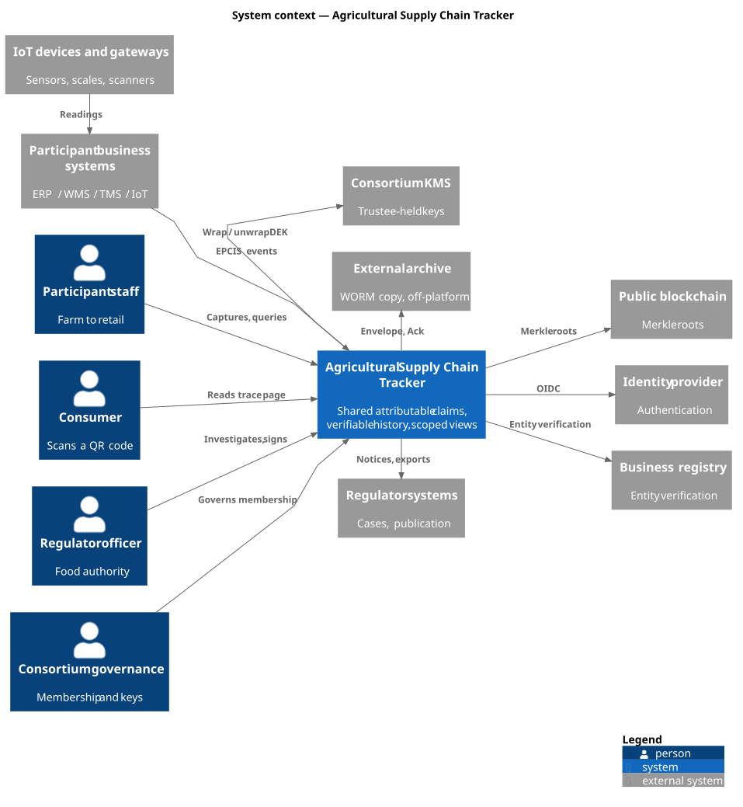
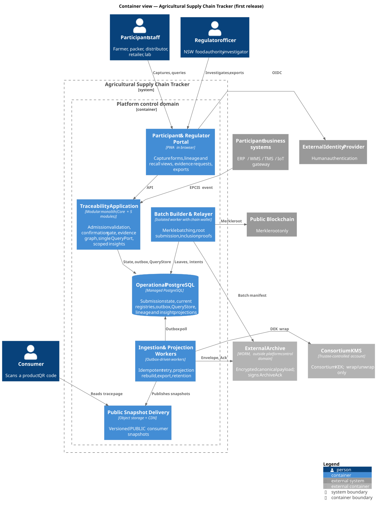
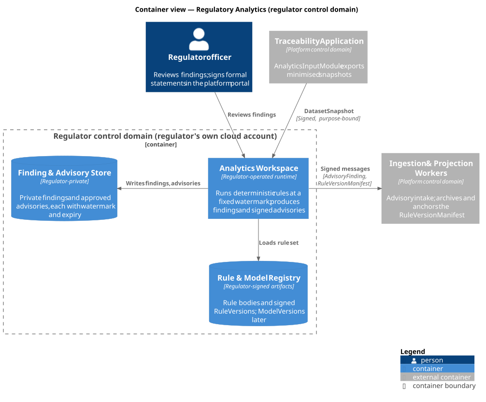
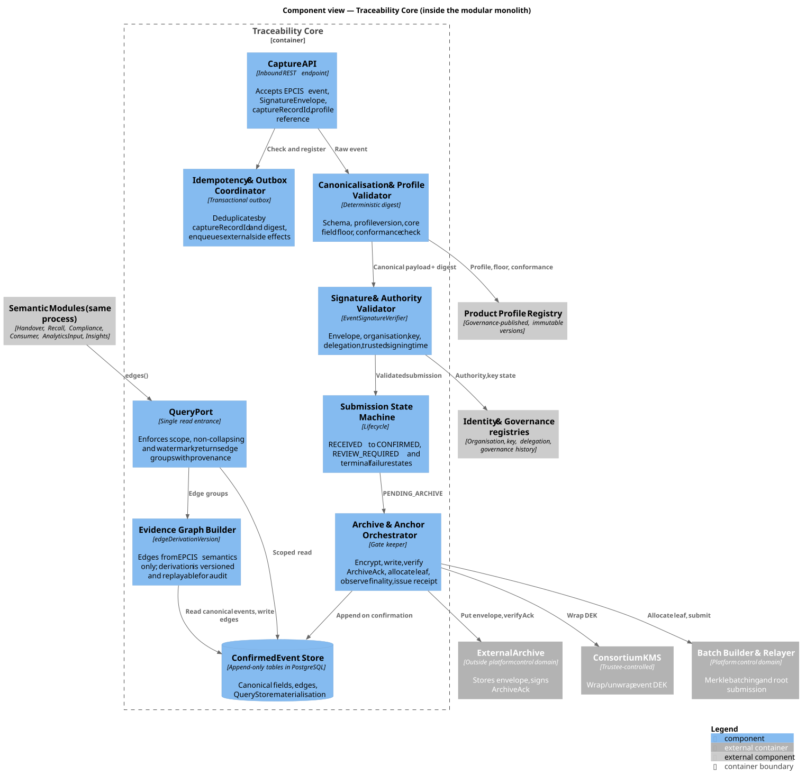
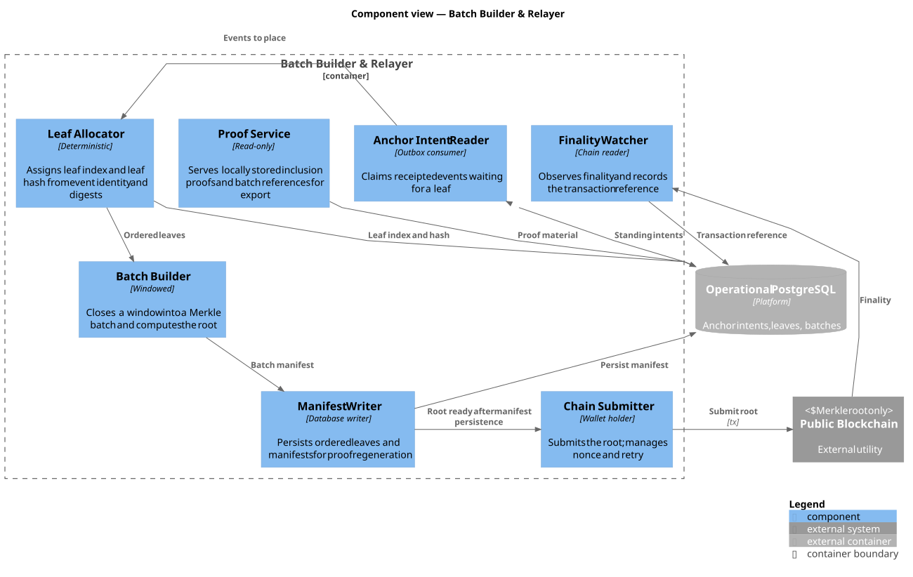
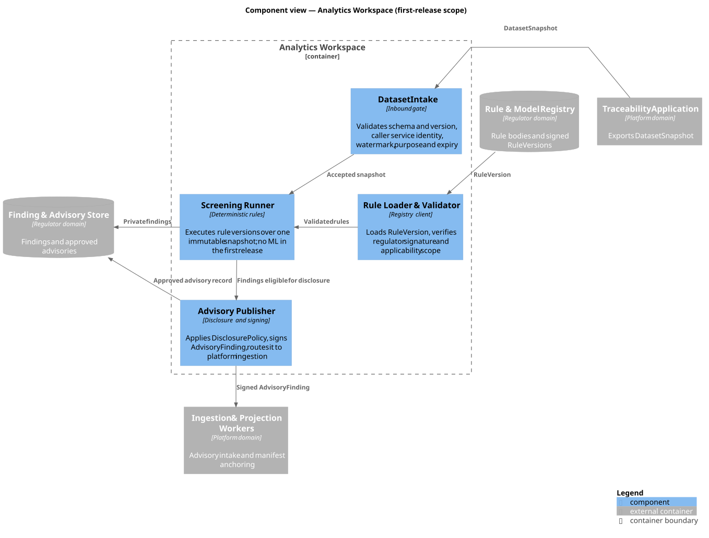
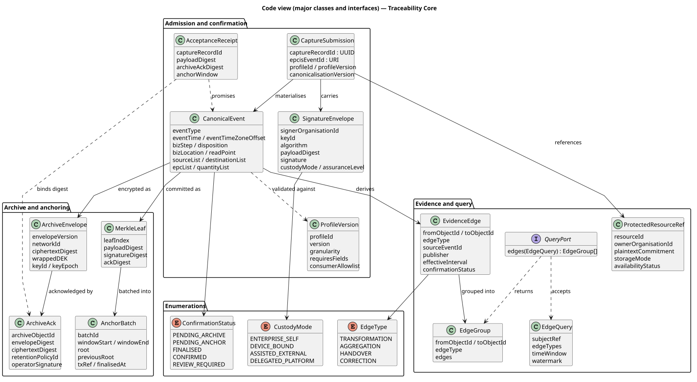
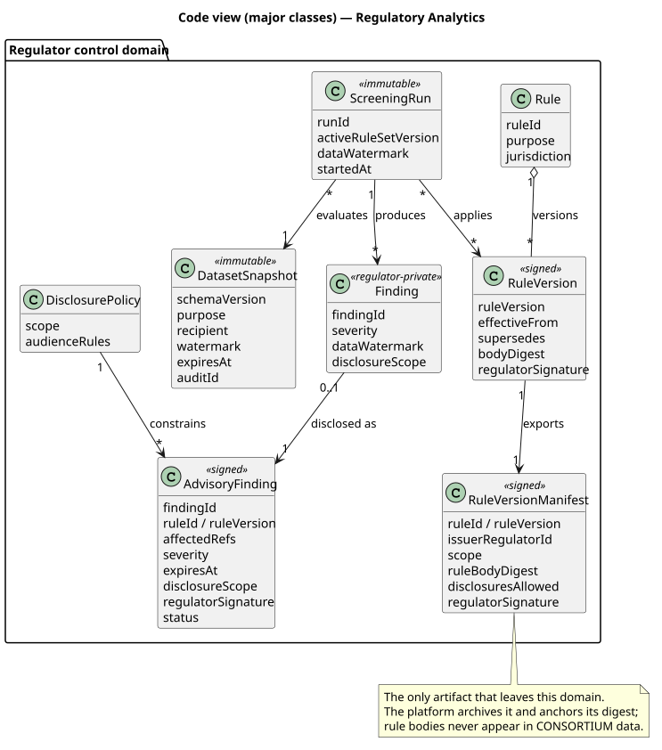

# 3. Architecture Views

Each view answers one question and narrows the previous one: the context fixes the boundary, the container view
opens it, the component views open the two containers that carry the guarantees, and the code views show the
types that make those guarantees enforceable. Section 4 explains why; this section states what the structure is.

## 3.1 View set

| View | Scope | Figures |
|---|---|---|
| Context | The system, its users and external systems | 1 |
| Containers | Runnable units, responsibilities, interactions | 2, 3 |
| Components | Traceability Core, the relayer, the analytics workspace | 4, 5, 6 |
| Code | Major classes, one interface, three enumerations | 7, 8 |

Names are stable across views; relationships carry intent, and transport strings appear only where the protocol
is architecturally relevant. Diagrams are generated from versioned source, so report and repository cannot drift.

## 3.2 System context

*Figure 1 — Two peer subsystems, four groups of users, eight external systems.*

**One boundary, two peer subsystems.** `Traceability Core` holds the shared record; `Regulatory Analytics` holds
the regulator's rule domain. They are peers: the platform cannot author rules, and analytics cannot rewrite the
trace. The archive, the consortium KMS, the chain and the regulator's case systems sit outside, because their
value comes from not being in the operator's account.

**Devices attach to participants, not to the platform.** Sensors feed the participant's own systems, which
publish EPCIS events. A device is a delegation of an organisation — allowed devices, locations and event types —
not a platform user. What enters the shared record is a profile-declared summary (min/max/mean, excursion
duration, alarm, with units and a time window) carried as an ordinary extension field; raw readings stay with
the participant behind a reference and a salted commitment. Collection and alarming are therefore local,
availability is the platform's, and verifiability is the archive's — one owner per tier (IoT-1…3, 4.B).

**Identity arrives on two lines.** Humans authenticate through an external identity provider; an organisation's
legal identity is verified once against a business registry. Neither is issued by the platform, which is what
makes the organisation, not the person, the unit of accountability.

## 3.3 Containers

*Figure 2 — Containers of the platform control domain, and the external systems they depend on.*

| Container | Responsibility |
|---|---|
| Participant & Regulator Portal | Role-specific capture, handover confirmation, recall execution, scan-to-trace, insight views, evidence requests |
| Traceability Application | Admission, the confirmation gate, evidence graph, the single read entrance |
| Ingestion & Projection Workers | Archive writes, projection rebuild, exports, retention, advisory intake |
| Batch Builder & Relayer | Leaf allocation, Merkle batching, root submission, inclusion proofs |
| Operational PostgreSQL | Submission state, registries, outbox, the plaintext query copy, projections |
| Public Snapshot Delivery | Versioned public snapshots at the edge |
| Analytics Workspace | Regulator's rules, screening, private findings, signed advisories |

Two boundaries are easy to misread. **The database holds a plaintext copy of confirmed events** (`QueryStore`),
not only indexes: online lineage cannot afford to decrypt on every hop. That copy is rebuildable, excluded from
the recovery guarantee and read-audited. **The Analytics Workspace sits inside the system boundary but outside
the platform control domain**, in the regulator's own account; only signed messages cross into it.

Four flows cross the boundary. *Capture*: a signed event reaches the application, which validates it, persists
state and enqueues an archive intent in one transaction; workers obtain a wrapped key, write the envelope and
record the acknowledgement; the relayer batches the leaf. *Read*: portal queries go through the query interface
and the plaintext copy only. *Public delivery*: workers publish versioned snapshots, the CDN serves them, and
consumers never reach the application. *Cross-tenant*: the application exports a minimised dataset and receives
signed advisories and rule manifests.

*Figure 3 — The workspace, its rule registry and its finding store.*

The separation is the point of this view: the platform can deploy artefacts into the regulator's account but
cannot read from or operate it, so "the platform cannot see the rules or the findings" is an IAM fact rather
than a promise. That contract — what dataset may leave, what may return — is why the subsystem is modelled to
component and code level instead of being drawn as a black box.

## 3.4 Components

*Figure 4 — Components of Traceability Core, with the modules that consume its read interface.*

The core has one write path and one read entrance. Nine components: `Capture API`, `Idempotency & Outbox
Coordinator`, `Canonicalisation & Profile Validator`, `Signature & Authority Validator`, `Submission State
Machine`, `Archive & Anchor Orchestrator`, `Evidence Graph Builder`, `Confirmed Event Store` and `QueryPort`.
Three properties carry the argument: the orchestrator owns the confirmation gate and records the archive intent,
while the worker role of the same image executes it; `QueryPort` exposes two graph-shaped operations, `edges()`
and a bounded `traverse()`, and no operation that returns a business status; the store is append-only, so a
correction is a new event.

*Figure 5 — Components of the relayer, the only container that touches a chain.*

The relayer is drawn separately because it is the only container with a credential that can spend money and
write to a public network. Six of its seven components need no private key; only `Chain Submitter` does. Leaf
allocation is deterministic, so a retry cannot create a second leaf for the same event, and the manifest writer
places the batch manifest beside the payload, which is what lets recovery reconstruct which batch held an
event without the platform database.

*Figure 6 — Four components, inside the regulator's account.*

`Dataset Intake` is the only entrance; `Rule Loader & Validator` verifies the regulator's signature and the
rule's applicability, not its content; `Screening Runner` runs deterministic rules over one snapshot at one
watermark; `Advisory Publisher` applies the disclosure policy and signs. There is no model loader and no review
queue in the first release, because it runs deterministic rules only.

## 3.5 Code

*Figure 7 — Thirteen classes, one interface, three enumerations.*

Four properties are visible in the type model. `SignatureEnvelope` has no natural-person field, so attribution
cannot acquire an employee reference. `AcceptanceReceipt` binds the `ArchiveAck` digest, so a receipt can only
exist once an outside holder has confirmed persistence. `QueryPort` returns edge groups, never a business
status, so no caller bypasses scope, non-collapsing or watermark. `ProtectedResourceRef` holds a salted
commitment and a storage mode, never content. The three enumerations are published values: once in use, a value
cannot be silently added or removed.

*Figure 8 — Eight classes.* `RuleVersionManifest` is the only artefact of the rule domain that leaves the
regulator's account, and it carries only a digest of the rule body. `Finding` and `AdvisoryFinding` share a
`findingId`, so an advisory is a disclosure of an existing finding and a retraction is the same identifier
re-signed; `DisclosurePolicy` constrains advisories, not findings.

## 3.6 Cross-view consistency

Every class is produced by one component and belongs to one container of Figure 2; Appendix A.2 is the full
mapping. Consistency is maintained by four rules rather than by review: one name per element across views, one
owning component per class, one interface per trust boundary, and enumerations treated as published contracts
rather than implementation detail.

## 3.7 What these views deliberately do not model

Screens, routes and component state of the portal (they change weekly); persistence mapping (2.3–2.4 and 4.7); and
generated clients, except where they are the contract. Deployment and dynamic behaviour are Section 4, where
they are used as evidence.
