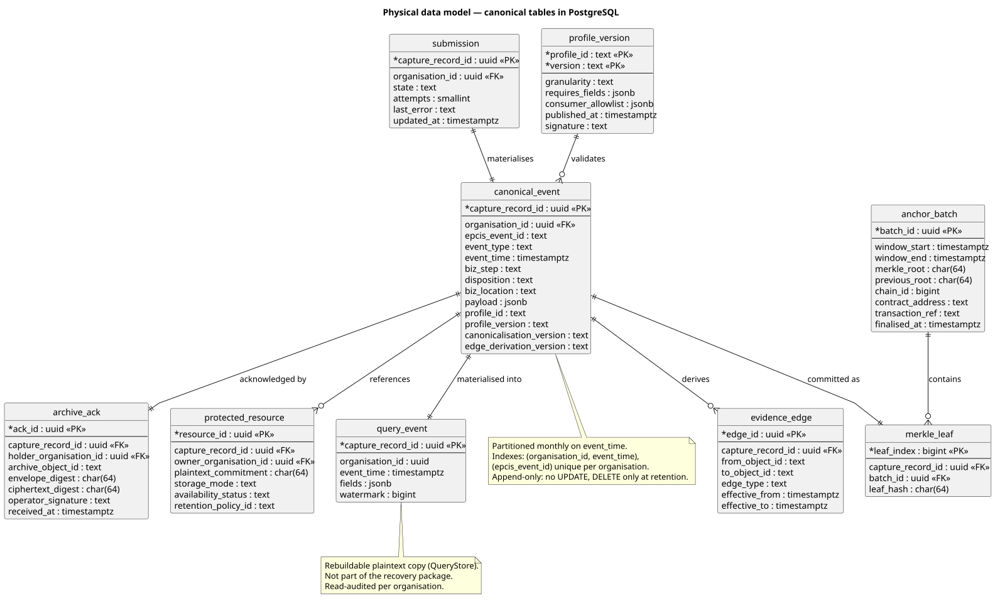
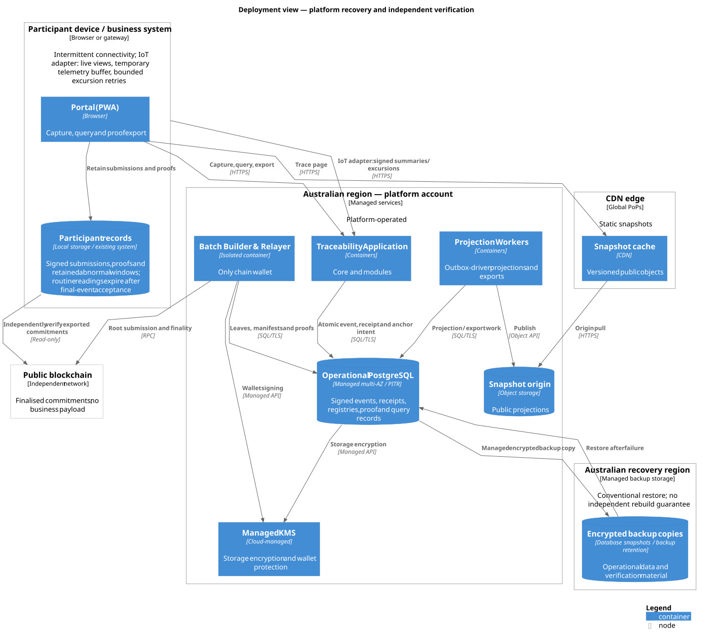
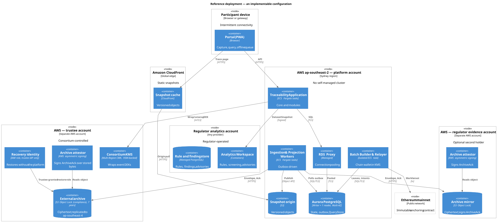
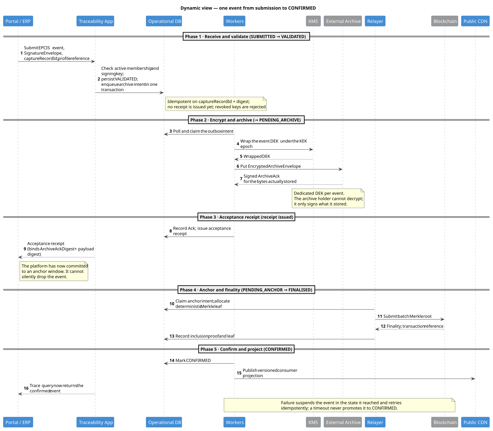
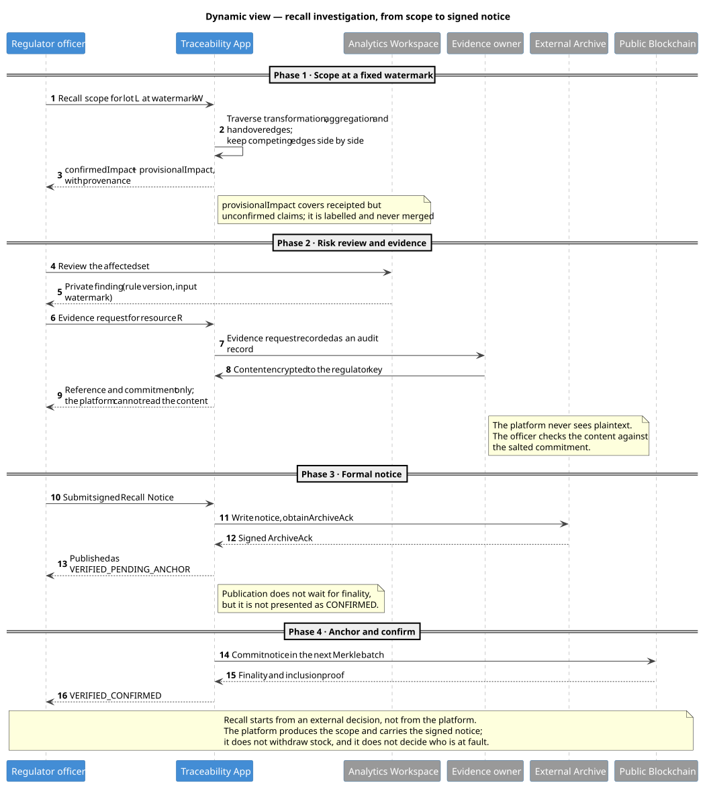

# 4. Architectural Rationale and Decision-Making

*Draft — untrimmed. Rows covered: 4.1–4.20 and the 4.B bonus.*

Sections 2 and 3 described what the system must do and what it looks like. This section explains why the
structure is the way it is: which quality each decision buys, which pattern carries it, and what was rejected.
Requirement identifiers (`SQ`, `DM`, `CL`, `SP`, `AI`, `IoT`) are the ones defined in Section 2.

## 4.1 Application architecture: quality requirements and where they are met

| Requirement | Structural mechanism | Where it lives |
|---|---|---|
| SQ-1 Integrity | Append-only canonical records, signed digest, external acknowledgement, Merkle inclusion, verifiable batch sequence | Archive & Anchor Orchestrator; relayer; external archive |
| SQ-2 Non-repudiation | One signature envelope for all custody modes; key history retained; acceptance-time authority separated from cryptographic validity | Signature & Authority Validator; key registry |
| SQ-3 Availability | Fail-closed writes with idempotent retry; reads continue from materialised data; analytics never in the write path | Submission State Machine; workers; outbox |
| SQ-4 Performance | Consumer reads served from versioned snapshots at the edge; lineage served from the plaintext query copy; bounded synchronous traversal | Snapshot delivery; `QueryStore`; RecallModule |
| SQ-5 Recoverability | The archive, not the database, is the authoritative copy; a recovery identity outside the platform can rebuild | External archive; recovery identity |
| SQ-6 Usability | Browser-first capture, durable offline queue, client-generated identifiers, device-bound signing where supported | Portal; offline queue; `CaptureSubmission` |
| SQ-7 Privacy | Three visibility classes with no middle tier; private content off-platform behind a salted commitment; no natural-person fields in the event model | Data classification; `ProtectedResourceRef`; `SignatureEnvelope` |
| SQ-8 Interoperability | EPCIS 2.0 / CBV; versioned profiles and canonicalisation; chain-agnostic leaves | Canonicalisation; profile registry; leaf format |
| SQ-9 Auditability | Watermarks on every projection; versioned edge derivation that can be replayed; findings bound to rule version and input watermark | `QueryPort`; Evidence Graph Builder; analytics manifest |
| SQ-10 Cost and operability | One modular application, one managed database, no broker, managed services, batched anchoring | Container view; deployment view |
| SQ-13 Analysability | Aggregates materialised over the confirmed projection at a watermark, served through the same scope and watermark rules as every other read | Insights module; 4.7 |

The remaining subsections take these one cluster at a time.

## 4.2 Quality tactics

Tactics are grouped by the quality they serve; each is stated as the tactic, then as the concrete mechanism.

**Integrity (SQ-1).** *Tactic:* make tampering detectable rather than prevent it.
- *Append-only data*: canonical rows are never updated; corrections are new events that reference the old one.
- *Signed digest*: the participant signs a canonical payload digest, so a change to content breaks the signature.
- *External acknowledgement*: the confirmation gate requires a signature from a holder outside the platform's
  control domain over the exact stored bytes; the platform cannot manufacture it.
- *Verifiable sequence*: batch roots commit to the previous root, so skipping or reordering batches is
  detectable, not merely unlikely.
- *Inclusion proof*: a member can prove its event is inside a published root without holding anyone else's data.

**Non-repudiation (SQ-2).** *Tactic:* separate the three questions that are usually conflated — was this
signed by that key, was that organisation allowed to sign then, and when was it signed. The design answers
them in three independent checks and never lets one imply another. Key rotation does not invalidate old
signatures, and a later compromise does not rewrite history.

**Availability (SQ-3).** *Tactic:* fail closed on writes, degrade explicitly on reads.
- *Idempotent retry*: every external side effect has a stable identifier, so a retry resumes rather than
  duplicates.
- *Outbox*: state change and side effect are committed together; the worker can crash at any point.
- *Materialised reads*: queries are answered from the local plaintext copy, so an archive or KMS outage
  reduces capability without stopping the product.
- *Optional dependency*: analytics is outside the write path by construction, and its absence is displayed
  rather than hidden.

**Performance (SQ-4).** *Tactic:* move work off the request path.
- *Cache at the edge*: consumer snapshots are versioned objects on a CDN; the origin sees a small fraction.
- *Precompute what is queried*: lineage is derived once and read from indexed tables, not recomputed per request.
- *Bound the synchronous case*: interactive traversal has a fixed edge budget; larger scopes become an export
  at a fixed watermark, which is both faster and more reproducible.

**Modifiability and interoperability (SQ-8).** *Tactic:* localise change.
- *Profile versioning*: new fields arrive as a new profile version; the core does not change.
- *Ports and adapters*: archive, KMS, chain and identity are accessed through interfaces, so a provider change
  is an adapter change.
- *Chain-agnostic leaf*: the leaf binds event identity and digests, not chain specifics; migration is metadata.

**Security (SQ-7, SP-1…SP-8).** *Tactic:* enforce at one point, audit at the boundary.
- *Single read entrance*: scope, non-collapsing and watermark are enforced in `QueryPort`, not in each caller.
- *Single signature verifier*: every custody mode flows through one verification component, so a new mode
  cannot quietly weaken the check.
- *Key separation*: the consortium key lives in an account the platform cannot administer; the chain wallet
  lives in an isolated container.
- *Break-glass*: platform staff have no standing plaintext access; access is time-boxed, dual-approved,
  recorded, and the record is anchored.

**Observability and testability (SQ-9).** *Tactic:* make state and derivation inspectable.
- *Watermarks*: every projection reports how far it has read.
- *Health separation*: platform-observed channel liveness is shown separately from the regulator's self-reported
  analysis health, because they fail independently.
- *Replayable derivation*: the edge set is a deterministic function of canonical events, so an auditor can
  recompute it and compare.

## 4.3 Architectural patterns

| Pattern | How it is applied | Quality it serves | Alternative rejected |
|---|---|---|---|
| **Modular monolith** | One deployable containing the core and six modules, called through ports | SQ-10, modifiability | Microservices per concern: operational cost with no measured scaling need |
| **Ports and adapters (hexagonal)** | Archive, key service, chain, identity and time are ports; provider SDKs live in adapters | SQ-8, testability | Direct SDK calls in domain code: vendor lock-in and untestable domain |
| **Transactional outbox** | Submission state and archive intent commit together; workers drain the outbox | SQ-3, SQ-1 | Two-phase commit across services, or fire-and-forget messaging that loses work |
| **Append-only log with derived projections (CQRS-lite)** | Canonical events are the write model; lineage, recall and public views are rebuildable projections | SQ-1, SQ-4 | Full event sourcing of the whole application: projection complexity without a requirement |
| **Pipeline of admission gates** | Validation is a sequence of explicit gates, each adding a stated guarantee | SQ-1, SQ-2 | One monolithic validation function with implicit ordering |
| **Notarisation (anchor)** | Periodic Merkle roots on a public chain provide an external existence checkpoint | SQ-1 | A permissioned ledger, which needs independent operators this project does not have |
| **Two control domains (separation of duties)** | Regulator analytics and archive custody live in accounts the platform cannot operate | SQ-7, SP-5 | One account for everything: cheaper, and it collapses the trust argument |
| **Isolated signer** | The only component holding the chain wallet is a separate deployment | SP-1, SP-5 | Wallet embedded in the main application: a much larger key-exposure surface |
| **Single façade for reads** | `QueryPort` is the only read entrance; nothing else touches canonical tables | SQ-1, SQ-7 | Direct table access from each module: every module becomes its own policy enforcer |

## 4.4 SOLID principles

**Single responsibility.** Each component has one reason to change, stated as one verb: *accept*, *deduplicate*,
*canonicalise*, *verify*, *advance state*, *orchestrate*, *derive*, *serve*. The clearest evidence is the split
between `Canonicalisation & Profile Validator` and `Signature & Authority Validator`: schema conformance and
cryptographic attribution change for entirely different reasons, and merging them would make a profile release
look like a security change.

**Open/closed.** New custody modes, new profiles and new archive holders are additions, not edits: a custody
mode is a new envelope producer plus a registry entry; a profile is a new immutable version; an archive holder
is a new signer satisfying the same acknowledgement contract. The core does not gain a branch for each.

**Liskov substitution.** All four custody modes produce the same `SignatureEnvelope` and are consumed by the
same verifier; any qualified archive holder is substitutable behind the acknowledgement contract. What must
*not* be substituted is the assurance level, which is carried explicitly rather than flattened — the interface
is uniform, the trust claim is not.

**Interface segregation.** `QueryPort` exposes two graph-shaped operations — one hop (`edges`) and a bounded
multi-hop read (`traverse`) — and nothing else. There is no god interface that also returns handover status,
compliance state or scores, precisely because such methods would let a caller bypass the rules the port exists
to enforce. Module contracts are narrow for the same reason.

**Dependency inversion.** The core depends on abstractions — an archive port, a key port, a signature verifier,
a clock — and never on a provider SDK. That is what allows the archive holder set to be configured, the KMS to
be replaced, and the chain to be migrated without touching domain code. The relayer is the deliberate
exception: chain-specific code is confined there, and that confinement is the point.

## 4.5 Avoidance of poor design

| Design smell | How it is avoided | Evidence |
|---|---|---|
| **Feature concentration** | The core is mechanism; business semantics live in six modules with declared dependencies | Core components in Figure 4; module table in Section 3.4.1 |
| **Scattered functionality** | One verifier, one state machine, one read entrance, one orchestrator that touches external systems | Figures 4 and 7 |
| **Dense structure** | Bounded component counts per container: core 9, relayer 7, workspace 4 | Figures 4, 5, 6 |
| **Cyclic dependency** | Dependency direction is one-way: modules → `QueryPort` → store; core → ports → adapters. The evidence graph is derived, so there is no back edge from graph to core | Figure 4 |
| **Unstable dependency** | Domain code depends only on interfaces; vendor SDKs, chain clients and provider formats are confined to adapters and the relayer | Figure 4 |

The dependency rules are worth stating as rules, because they are what keeps the diagram from decaying:

| From | To | Allowed |
|---|---|---|
| Semantic module | `QueryPort` | Yes |
| Semantic module | Canonical tables | **No** — no module may read them directly |
| Core | Semantic module | **No** — the core does not know modules exist |
| Core | Provider SDK (archive, KMS, chain) | **No** — only through ports |
| Adapter / relayer | Provider SDK | Yes — this is the only place |
| Relayer | Application | **No** — it is a separate deployment with its own credential |

## 4.6 Context-level data architecture

The data analytics system appears in the system context (Figure 1) as `Regulatory Analytics`, the second of the
two peer subsystems inside the system boundary, running in the regulator's own account. Two data-architectural
facts follow from that placement: it consumes a *minimised, purpose-bound dataset snapshot* rather than raw
tables, and it produces two data products — private findings and signed advisories — that return to the
platform as messages, not as rows.

The other data-bearing externals are equally explicit: the external archive is the authoritative store for
encrypted payloads, the consortium KMS holds the keys that make that store readable, and the public chain holds
only commitments. A context diagram that omitted these would leave the reader unable to tell where data
actually lives, which is exactly what this design refuses to leave implicit.

## 4.7 Container-level data architecture

| Data role | Container | Contents | Rebuildable? |
|---|---|---|---|
| Operational record | Operational PostgreSQL | Submission state, current registries, outbox, projection tables | Yes, from canonical events |
| Queryable canonical copy | Operational PostgreSQL (`QueryStore`) | Canonical fields and derived edges in plaintext | Yes; excluded from recovery guarantee |
| Authoritative payload | External archive (outside the platform) | Encrypted canonical payload, signature, envelope, manifest | **No** — this *is* the copy of record |
| Public data mart | Snapshot origin + CDN | Versioned public projections | Yes |
| Analytical mart | Insights materialised views (inside Operational PostgreSQL) | Aggregates over confirmed data; no private content | Yes |
| Regulatory data | Analytics stores (regulator account) | Rule bodies, versions, findings, advisories | Rules are signed and reproducible; findings are evidential |

**ETL/ELT.** Three flows exist and no more. (1) *Extract for analytics*: a scheduled, purpose-bound export of a
minimised snapshot with schema version, watermark and expiry. (2) *Load for insights*: a nightly job materialises
aggregates into the mart; it reads only the confirmed projection and never private content. (3) *Export for
investigation*: an on-demand, case-bound dataset at a fixed watermark.

**Warehouse and lake.** A dedicated data warehouse is deliberately out of scope for the first release: the
volume (10 000 events/day) is served by a mart built from materialised views, and a warehouse would add a
second consistency boundary without a query it needs to answer. A data lake is rejected outright — raw files
would duplicate private content and weaken the classification model.

**Backup facilities.** Three independent mechanisms: continuous backup with point-in-time recovery for
operational state (RPO ≤ 5 min), cross-region snapshot copies for regional rebuild (RTO ≤ 24 h), and the archive
replicas held by qualified holders for the copy of record. None of them is the same trust domain as the others,
which is the point.

## 4.8 Component-level conceptual and logical model

Figure 4 fixes which component owns each entity; the table below gives the concepts and their relationships;
Figure 9 gives the physical tables they become.

| Concept | Represents | Key relationships |
|---|---|---|
| Submission | One attempt to publish an event, with its idempotency identity | Materialises exactly one canonical event |
| Canonical event | An attributable assertion in shared history | Validated against one profile version; acknowledged once; committed as one leaf; references zero or more evidence records |
| Evidence edge | A lineage relation derived from an event | Many per event; grouped by endpoints and type for presentation |
| Evidence reference | A pointer to content the platform does not hold | Belongs to one event, one owner |
| Archive acknowledgement | A holder's signature over stored bytes | One per event per holder |
| Anchored leaf and batch | The event's position in a published commitment | Many leaves per batch; batches chain to predecessors |
| Profile version | The schema and floor an event was validated against | Many events per version; immutable |
| Finding and advisory | The regulator's interpretation, and its disclosure | Advisory shares the finding's identifier |

The logical invariants that the model enforces are: exactly one canonical event per receipted submission;
exactly one leaf per canonical event; at least one acknowledgement before a receipt can exist; no update to a
canonical row; and every edge traceable to a single source event.

## 4.9 Physical data model

*Figure 9 — Physical tables, keys and the two materialisations that keep the write and read paths separate.*

| Table | Partitioning and keys | Notes |
|---|---|---|
| `submission` | PK `capture_record_id`; index on `(state, updated_at)` | The retry queue is a query, not a separate system |
| `canonical_event` | PK `capture_record_id`; monthly partitions on `event_time`; unique `(organisation_id, epcis_event_id)`; index `(organisation_id, event_time)` | Append-only; deletion only at retention |
| `evidence_edge` | PK `edge_id`; indexes `(from_object_id, edge_type)` and `(to_object_id)` | Derived; rebuildable from canonical events |
| `archive_ack` | PK `ack_id`; index `capture_record_id` | One row per holding acknowledgement |
| `merkle_leaf` / `anchor_batch` | PK `leaf_index` / `batch_id`; unique `capture_record_id` | Uniqueness is what makes anchoring idempotent |
| `protected_resource` | PK `resource_id`; index `owner_organisation_id` | Holds a commitment, never content |
| `profile_version` | PK `(profile_id, version)` | Immutable |
| `query_event` | PK `capture_record_id`; index `(organisation_id, event_time)` | The plaintext copy; rebuildable, read-audited |

Two physical choices carry design meaning. **`payload` is JSONB**, and holds only the EPCIS fields the platform
does not itself query — EPC and quantity lists, their units, transformation identifiers — validated at
admission against the profile but never the subject of a uniqueness, ordering or scope rule. Everything the
platform enforces is a typed column, because a constraint that lives in unindexed JSON is not a constraint.
**Row-level predicates on `organisation_id`** back the application's scope filter, so a coding mistake in one
module cannot silently widen a read.

## 4.10 Data architecture justification

| Requirement | How the data architecture satisfies it |
|---|---|
| DM-1 interpretability | Canonical event stores the profile and canonicalisation versions needed to re-read it; extension fields are declared by the profile |
| DM-2 private content stays off-platform | Only a commitment and a storage mode are stored; content lives with the owner or as ciphertext |
| DM-3 one authoritative source, rebuildable copies | The archive is the copy of record; the database states which tables are rebuildable and which are not |
| DM-4 per-class retention, legal hold, defensible deletion | Retention is a state machine with a three-party execution path and an anchored deletion record |
| DM-5 no natural-person identifiers | The event model has no such field, and the signature envelope carries no actor identity |
| DM-6 reproducible regulatory outputs | Findings carry rule version and input watermark; the derivation rules are versioned |

## 4.11 Cloud requirements alignment

| Requirement | Mechanism |
|---|---|
| CL-1 no capex, no infrastructure team | Managed services throughout; participants use a browser |
| CL-2 elastic consumer capacity | Versioned objects on a CDN; stateless application scale-out |
| CL-3 Australian residency and cross-failure-domain durability | Sydney primary, Melbourne copy for snapshots and archive; private data never leaves Australia |
| CL-4 independent control domains | Four accounts, four owners; the regulator and the trustee hold their own accounts |
| CL-5 managed security operations | Provider-managed IAM, key management, audit logs, patching |
| CL-6 exit and portability | EPCIS payloads, portable archive envelope, chain-agnostic leaf, standard SQL database |

## 4.12 Cloud-native principles applied

1. **Managed services over servers.** No database fleet, no Kubernetes cluster, no self-managed message broker.
2. **Stateless compute with externalised state.** Application and worker instances hold no local state; all state
   is in the database or the archive.
3. **Immutable artefacts.** The same image runs as application or worker, with the role selected by configuration.
4. **Declarative infrastructure.** Accounts, networks, buckets, policies and keys are described in code; the
   regulator's and trustee's environments are delivered as artefacts rather than operated remotely.
5. **Horizontal scale by role.** Workers scale on outbox lag; the application scales on request rate; the relayer
   is deliberately not horizontally scaled.
6. **Resilience by redundancy and retry.** Multi-AZ database, idempotent external effects, exponential backoff,
   and stable identifiers per side effect.
7. **Observability as a first-class output.** Watermarks, lag, backlog age and two independent health signals.
8. **Least privilege and account boundaries.** Separate accounts are treated as security boundaries, not as
   billing labels.
9. **No pets.** Every instance is replaceable; nothing is patched by hand.

## 4.13 Cloud-native justification

Each principle is tied to a requirement and to a cost it is willing to pay:

- Managed services (CL-1, SQ-10) cost more per unit than self-managed, and are chosen anyway because the
  alternative is a team the project does not have.
- Stateless compute (SQ-3) means every request pays a small hydration cost; that is traded for trivial failover.
- Immutable artefacts (SQ-8) remove configuration drift; the price is that a role change requires a redeploy.
- Declarative infrastructure (CL-4) is what makes "the platform can deploy artefacts into the regulator's
  account but cannot read from or operate them" a property of the delivery pipeline rather than a promise.
- Horizontal worker scaling (SQ-4) costs concurrency complexity in the outbox; the alternative — a single worker —
  would make backlog a single-node problem.

Two deliberate deviations from cloud-native fashion are recorded rather than hidden: the database is a single
managed primary with a reader (not a distributed SQL system), and the deployment is single-region with warm
copies rather than active-active. Both are consequences of C5 (pilot scale) and are revisited only on measured
pressure.

## 4.14 Deployment infrastructure

*Figure 10 — Logical placement: which control domain owns which node, without naming products.*

*Figure 11 — A reference configuration that can be procured and built.*

The logical view and the reference view are kept separate on purpose. The logical view answers "who owns what,
and where does it run"; it should survive a change of provider. The reference view answers "what do we actually
build for the pilot", and it must name products or it cannot be estimated or built.

The reference configuration uses a single Australian region for the platform, a second Australian region for
cross-region copies, and two separate accounts for the regulator (analytics and evidence) and one for the
trustee (archive, keys, recovery identity). Failure domains are explicit: the database is multi-AZ within the
region, and the archive is replicated across regions in a different account, so no single regional event
removes both the service and the copy of record.

## 4.15 Container and execution environments

| Workload | Execution environment | Scaling unit | Credentials | Network path |
|---|---|---|---|---|
| Application | Managed container tasks | Task count on request rate | Task role, no static keys | Public ingress via load balancer; egress to KMS and database only |
| Workers | Same image, worker role | Task count on outbox lag | Task role limited to the archive and object store | Egress to archive holders; no inbound |
| Relayer | Isolated task, no inbound | Single instance by design | Chain wallet through KMS signing; no other permissions | Egress to the chain only |
| Database | Managed relational service | Instance class; reader for exports | IAM authentication | Private subnet |
| Archive | Managed WORM object storage, trustee account | Provider-managed | Trustee-owned key; platform cross-account role with no delete | Private endpoint |
| Keys | Managed KMS, trustee account | Provider-managed | Platform role with wrap/unwrap only | API calls over TLS |
| Public delivery | Object storage plus CDN | Provider-managed | Origin access identity | Global |

The relayer row is the one that matters: it is the only workload with a credential that can spend money and
publish to a public network, so it has no inbound path, no database write role beyond anchor intents, and no
ability to read canonical payloads.

## 4.16 Dynamic view

*Figure 12 — One event from submission to confirmed visibility, in five phases and sixteen steps.*

The scenario was chosen because it exercises every boundary in the system: participant to platform, platform to
archive holder, platform to key service, platform to chain, and platform to the public. Sixteen steps carry one
event through five phases: receive and validate, encrypt and archive, receipt issued, anchor to finality,
confirm and project.

The ordering is the argument. A receipt is issued only after an external holder has signed for the bytes (steps
7–8), and confirmation happens only after finality (step 14). No timeout promotes an event: a failure suspends it
in the state it reached and retries idempotently. That is what allows the system to claim that `CONFIRMED` means
"archived outside the operator's control and anchored", and nothing weaker.

## 4.17 Data flow through the dynamic view

The same figure can be read as a data-flow diagram, and it is useful to do so because each hop changes the
classification of the data:

| Step | Data crossing | Classification | Boundary crossed |
|---|---|---|---|
| 1–2 | Canonical event, signature, identifiers | Consortium | Participant → platform |
| 4–6 | DEK, envelope, ciphertext | Consortium (encrypted) | Platform → KMS, platform → archive holder |
| 6–7 | Signed acknowledgement over stored bytes | Consortium | Archive holder → platform |
| 8–9 | Receipt; anchor intent and leaf | Consortium | Platform → participant (receipt only) |
| 10–13 | Merkle root; transaction reference; inclusion proof | Public commitment | Platform → public chain |
| 14–15 | Versioned public projection | Public | Platform → CDN |
| 16 | Trace page for the submitter | Consortium | Application → portal |

Step 16 is the submitter reading the confirmed event back. The consumer read is served by the CDN from the
projection published in step 15 and is not a step in this figure: consumers never reach the application.

*Figure 13 — The read and regulatory path: scope at a watermark, evidence request, signed notice.*

The second dynamic view covers the path that matters for privacy: a recall investigation. Here the flow is
different in kind — the platform produces a scope at a fixed watermark, returns confirmed and provisional sets
separately, converts an evidence request into an audit record rather than a data pull, and never sees the content
that the owner sends to the regulator. The only content that leaves the private domain is what the owner chooses
to encrypt to the regulator's key.

## 4.18 Threat-model boundaries and entry points

| Boundary or entry point | What crosses | Enforcement | Failure mode |
|---|---|---|---|
| Participant API | Signed events, queries | Signature and authority validation; organisation binding; rate limits | Reject with a retryable error; no partial acceptance |
| Portal | Human sessions, capture forms | External IdP; per-request acting organisation; role scopes | Session invalid; capture disabled, offline queue retains drafts |
| Cross-tenant channel to analytics | Dataset snapshots; advisories; rule manifests | Signed messages on both directions; transport identity is not authority | Ingestion rejects unsigned messages; analytics unavailability degrades only advisories |
| Archive holder boundary | Envelope out; acknowledgement in | Capability contract (signs stored bytes); eligibility and independence tests | Event stays in pending-archive; the gate does not advance |
| Key service boundary | Wrapped keys; unwrap requests | Policy denies platform delete/admin; key policy per epoch | Writes stop at pending-archive; reads continue from the materialised copy |
| Chain boundary | Merkle roots out; finality in | Immutable contract; relayer-only wallet; deterministic leaves | Events stay pending-anchor; public notices can still publish as pending |
| Platform staff boundary | Operational access | No standing plaintext access; break-glass with dual approval, recording, anchored record | Break-glass requires approval; refusal is itself recorded |
| Onboarding boundary | Organisation identity and keys | Entity verification, sponsor, dual approval, read audit | Registration is delayed; no partial membership |
| Evidence owner boundary | Request out; encrypted content in | Request recorded as audit; platform cannot decrypt | Content unavailable is recorded as "cannot confirm", never as "not provided" |

The trust boundaries that matter most are the three that leave the platform's account: to the archive holder, to
the key service, and to the regulator. All three are crossed only with signed messages whose verification does
not depend on the platform's own claims.

## 4.19 STRIDE threats and mitigations

| Category | Threat | Where | Mitigation | Residual |
|---|---|---|---|---|
| Spoofing | A participant forges another organisation's event | Capture API | Envelope signature over canonical digest; key-to-organisation binding; authority check at acceptance | A compromised participant key is indistinguishable until revoked; revocation is a governance action |
| Spoofing | The platform impersonates a participant to publish | Any write path | No custody mode allows the platform to sign for a self-custody organisation; delegated custody is labelled | Delegated-custody participants accept platform signing by choice |
| Tampering | A host or administrator modifies stored history | Database, archive | Append-only rows; signed digests; external acknowledgement; Merkle inclusion | A modified row is detectable, not prevented |
| Tampering | Batches are skipped or reordered | Relayer, chain | Roots commit to the previous root; consistency proofs | Requires chain finality to be observed, which is asynchronous |
| Repudiation | A participant denies publishing an event | Dispute | Non-repudiable signature; independent timestamp evidence where available; key history retained | Keys held by a third party shift, not remove, the question |
| Repudiation | The operator denies having shown an advisory | Dispute | Platform advisory store keeps the signed payload and receipt time; issuer keeps its own copy | No chain trace for routine advisories, by design |
| Information disclosure | Private evidence leaks | Evidence store | Content never on platform; owner-encrypted recipients; salted commitment | Metadata (who, when, size) is visible |
| Information disclosure | A member reads data outside its scope | `QueryPort` | Scope enforced at the single read entrance; row predicates; read audit | In the pilot all members share the consortium scope — an accepted, documented assumption |
| Denial of service | Event flood from one participant or device | Capture API, workers | Per-organisation quotas; outbox backpressure; bounded queue; retry with jitter | Sustained flood degrades other participants' latency |
| Denial of service | Regulator attestor unavailability blocks confirmation | Archive gate | Holder set with quorum of one, at least two configured holders | If every holder refuses, writes stay pending and the refusal is visible |
| Elevation of privilege | A platform operator reads plaintext without approval | Operations | No standing access; break-glass with dual approval and recording; anchored access record | A compromised break-glass path is a high-severity incident, not a silent one |
| Elevation of privilege | A regulator reaches private evidence outside a case | Cross-tenant, evidence | Case-scoped grants; audit record per request; content encrypted by the owner | The regulator holds a ciphertext mirror; decryption still needs a key grant |

## 4.20 Security and privacy justification

| Requirement | Where it is met | Residual risk accepted |
|---|---|---|
| SP-1 authenticated, organisation-bound writes | Envelope plus per-request acting organisation; authority resolved from registries | Compromised participant credentials |
| SP-2 non-repudiation across rotation | Key history retained; acceptance-time authority recorded | Keys delegated to providers |
| SP-3 platform cannot read private content | Content off-platform; owner-chosen recipients; commitment only | Metadata and access patterns |
| SP-4 no personal data in immutable history | No such field in the event model; personal data only in the mutable registry | Indirect identification through locations and small-farm identifiers |
| SP-5 dual control for high-impact change | Dual control list; anchoring before effect | Colluding approvers |
| SP-6 audited reads, break-glass for staff | Read audit by organisation; break-glass path | Platform runtime can read consortium plaintext |
| SP-7 analytics cannot pull arbitrary evidence | Dataset snapshots; owner-encrypted evidence only | The regulator holds a mirror and may be compelled to disclose it |
| SP-8 explicit non-guarantees | Stated in the context and data views | None claimed |

The privacy argument rests on three moves rather than on a single control: **no personal fields in the shared
record**, so correction and deletion never have to negotiate with an immutable log; **content not on the
platform**, so the platform cannot be compelled to hand over what it does not hold; and **classification by
construction**, so there is no "sensitive but shared" middle tier that would need field-level policy. What remains
is metadata, and metadata is treated as data with its own minimisation and retention.

Three residual risks are stated rather than mitigated: a compromised platform runtime can read consortium
plaintext; a sufficiently resourced colluder can assert a false reality; and a third-party holder's copy may be
disclosed under its own legal obligations.

## 4.B AI/ML and IoT architecture (bonus)

The architecture supports AI/ML and IoT integration without letting either enter the critical write path.

**AI/ML.** Requirements AI-1 to AI-3 are met structurally, not by intent:

- *AI-1 deterministic first.* Screening runs in the regulator's workspace over deterministic, signed rule
  versions. A model is an alternative implementation of the same interface, not a second path — which is why the
  first release has no model loader and loses nothing.
- *AI-2 reproducibility.* Every finding carries its rule or model version and its input watermark; training
  data is produced as a purpose-bound snapshot with a schema version, so a model can be reproduced from the same
  inputs.
- *AI-3 human decision.* No output becomes an action: findings are private, advisories are reminders, and a
  formal consequence requires an officer's signature on a canonical event.

**IoT.** Requirements IoT-1 to IoT-3 are met by placing the boundary at the participant:

- *IoT-1 summary not telemetry.* The shared record carries profile-required summaries; raw readings stay with
  the owner behind a commitment. At dispute time the owner can prove that the summary came from the raw data
  without publishing it.
- *IoT-2 device identity without accounts.* Devices are registered as organisation delegations, so a fleet of
  sensors does not become a fleet of platform users.
- *IoT-3 three latency tiers.* Real-time collection and alarming happen at the edge and in the participant's
  system; near-real-time availability happens at receipt; final verifiability happens at confirmation. The
  platform deliberately does not own the cold-chain control loop.

**Rejected alternatives.** Raw telemetry upload (turns a traceability layer into a time-series warehouse and
creates a privacy liability); platform-side real-time alerting (puts a latency requirement in the write path and
duplicates the participant's control loop); ML at admission (makes a model an adjudicator and breaks
reproducibility); training on the platform's copy of consortium data (treats data the platform should not own as
a training asset); edge ML for compliance (moves versioned, auditable logic into an unauditable place).

**Why this is architecture rather than decoration.** Both capabilities are placed where their failure cannot
break the record: an analytics outage degrades advice, and a sensor outage degrades evidence, while ingestion,
confirmation and recovery continue. The optionality is in the technique (ML or not), never in the subsystem that
owns the decision.
